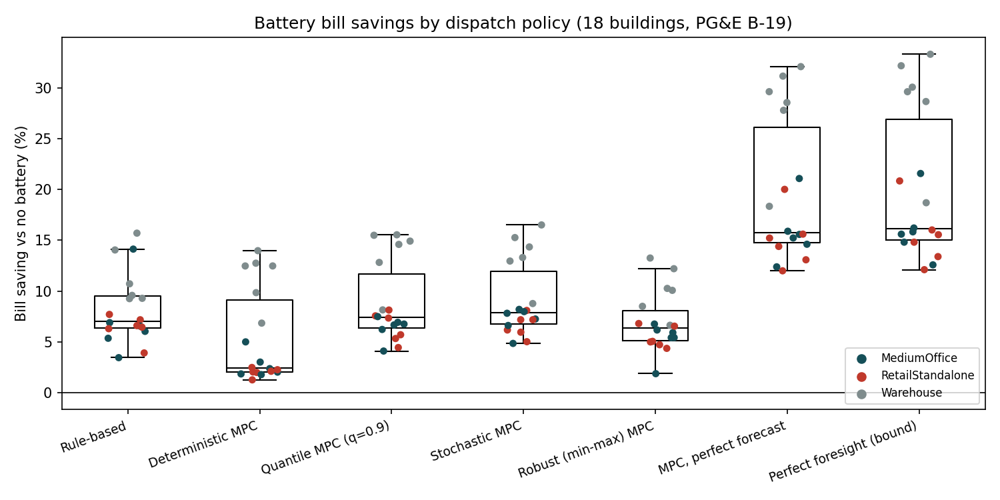
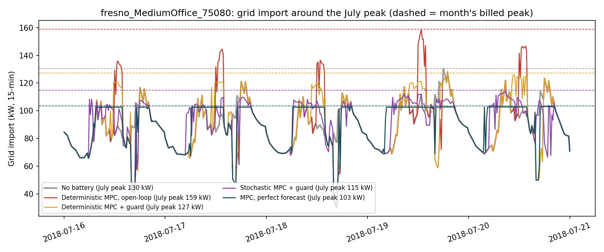

# Battery Dispatch Under Demand Charges: MILP, MPC and the Cost of Forecast Error

**Economic dispatch of a behind-the-meter battery + PV system for commercial buildings on a real
tariff (PG&E B-19), with a solver-agnostic Pyomo model, rolling-horizon MPC and a controlled
comparison of how to handle forecast uncertainty.**

[Showcase page](https://dgh19981102-max.github.io/microgrid-dispatch-milp/) ·
[Full results](results/summary/RESULTS.md) · [中文说明](README_zh.md) ·
[学习指南 (Chinese learning guide)](LEARNING_GUIDE_zh.md)



## Questions and answers

18 simulated commercial buildings (NREL ComStock: medium offices, retail stores, warehouses in
a mild and a hot California climate), 15-minute resolution, Feb–Dec (10.9 months), PV sized to
30 % of annual energy, 2-hour battery at 25 % of the annual peak. Savings are relative to the
same building with PV but no battery; 95 % bootstrap CIs over buildings.

| Question | Answer |
|---|---|
| How much can the battery save at best? | **20.1 %** of the bill [17.0, 23.5] with perfect foresight. MPC with a 24-h window and perfect forecasts reaches 97.7 % of that, so the horizon is not the problem. |
| How much do realistic controllers get? | Stochastic MPC **9.1 %**, quantile MPC 8.8 %, a well-designed rule 8.3 %, robust min-max MPC 6.9 %, deterministic MPC 5.4 %. The best capture ~46 % of the bound. |
| Does handling uncertainty pay? | Yes versus deterministic MPC: stochastic MPC is better in **18/18** buildings (+3.7 pp, CI [3.0, 4.4]). Versus the rule the gain (+0.8 pp, CI [−0.6, 2.1]) is **not significant**. Min-max is too conservative (worse than stochastic in 18/18). |
| What is forecast accuracy worth? | Highly non-linear. Savings fall from 19.6 % (perfect) to 7.7 % at half of today's error, then flatten. Near today's accuracy, a 10 % smaller error is worth only ~**$174 per building per year**. |
| Does *how* set-points are executed matter? | As much as the algorithm. Executed open-loop (fixed hourly set-points, no real-time demand guard), deterministic MPC **loses 1.5 %** and is worse than no battery in 11/18 buildings; the guard adds 5–7 pp to every policy. |
| Are the binary variables needed? | Not under B-19: 0 MILP fallbacks in **2.3 million** MPC solves. They are needed with negative prices (LP invalid in 65 % of windows) or export prices above import prices (54 %). |
| How big should the battery be? | Savings grow with size but each kWh is worth less: the 10-year break-even capex falls from $3,354/kWh (10 % of peak) to $1,610/kWh (50 %), upper bound. With the realistic controller at 25 %: about **$1,035/kWh**. |

## Why this is harder than it looks: the demand-charge ratchet

Under B-19, demand charges are **49–67 %** of the dispatch-dependent bill and are billed on the
highest 15-minute import of the **month**. Once a peak is set it cannot be undone, and every
later decision treats import up to that level as free. A deterministic MPC that under-forecasts
load schedules charging, the real load comes in higher, the peak ratchets up, and the controller
then happily charges up to the new level. The figure shows one July week:



## What is in the repository

```
src/mgdispatch/
  tariff.py      TOU energy + monthly demand charges, declarative YAML, DST-aware
  model.py       Pyomo MILP (deterministic / two-stage stochastic / min-max), variable step lengths
  solve.py       solver-agnostic solve (HiGHS, CBC, Gurobi, CPLEX) + LP-first with MILP fallback
  fastlp.py      the same LP assembled as a sparse matrix for HiGHS (10x faster, cross-tested)
  billing.py     independent bill calculator used to score every policy
  data.py        ComStock / NSRDB / PVGIS loading, time-zone alignment, pvlib PV model
  checks.py      verification of the load time zone from exterior-lighting switch-on vs sunset
  forecast.py    causal load / PV forecasters and error-trajectory scenario sampler
  simulate.py    15-min plant, real-time demand guard, rule-based policy, MPC variants
  runner.py      resumable experiment runner (weekly checkpoints, one JSON per run)
experiments/     00-09 numbered scripts, configs/*.yaml, run_all.py (sharded), plan.py
tests/           66 unit tests (hand-solved optima, Pyomo vs direct LP, causality, resume)
results/         runs.jsonl per experiment (one line = one run; unpack: experiments/pack_results.py --unpack), summary/RESULTS.md, figures
docs/            GitHub Pages showcase
```

## Method in brief

* **Data** – NREL ComStock AMY2018 release 3 (15-min loads, 3 buildings × 3 types × 2 counties,
  chosen by a fixed rule: closest to the county median annual kWh), the NSRDB-based weather file
  ComStock used, PV from pvlib (validated against PVGIS: annual yield within 3.7–5.2 %, hourly
  correlation 0.97–0.98). ComStock time stamps are **EST, not local time**: verified from the
  exterior-lighting switch-on, which lags the Pacific-standard sunset by 2.7–2.9 h in every month.
* **Tariff** – PG&E B-19 secondary, rates effective 2026-03-01 (peak 16–21 h every day,
  max-demand, peak and part-peak demand charges). Periods are evaluated in local clock time
  including DST.
* **Model** – LP/MILP with battery dynamics, charge/discharge and import/export exclusivity,
  PV curtailment, per-month demand-charge blocks with "peak so far" for rolling horizons,
  expected-cost or worst-case objectives, non-anticipativity of the implemented hour.
* **MPC** – hourly re-planning, 24-h window (4 h at 15 min + 20 h hourly = 36 steps),
  terminal value for stored energy. Variants: point forecast, 0.9-quantile forecast, 10
  bootstrapped error scenarios (expected cost or min-max), perfect forecast.
* **Experiments** – 468 simulation runs (26 per building), 3 scenario-sampling seeds,
  27.5 CPU-hours on free Colab CPUs with resumable checkpoints on Google Drive.

## Reproduce

```bash
pip install -r requirements.txt
python -m pytest -q                                   # ~1 min
python experiments/01_prepare_data.py                 # needs data/raw (scripts/download_data.py)
python experiments/run_all.py --quick                 # smoke test, ~3 min
python experiments/run_all.py --shard 0/2             # full run (two shards in parallel)
python experiments/06_milp_vs_lp.py && python experiments/07_solvers.py
python experiments/08_summarize.py && python experiments/09_dispatch_example.py
```

`data/processed/` is included, so experiments 02–09 run without downloading raw data.
`run_experiments_colab.ipynb` runs everything on free Colab with results on Google Drive.
Solver choice is one line in `experiments/configs/base.yaml`.

## Limitations (read before using the numbers)

* **Simulated loads.** ComStock profiles are smoother and more regular than metered data (load
  forecast nMAE 3–8 %). With real meters the forecast penalty is likely larger.
* **Mixed years.** 2018 loads and weather are billed with the 2026 tariff; holidays, Peak Day
  Pricing, taxes and power-factor adjustments are ignored; export value is a flat $0.05/kWh
  assumption rather than the hourly Net Billing Tariff values.
* **Uniform sizing.** PV and battery follow fixed ratios; B-19 is applied to all buildings
  although the smallest ones may be better off on another PG&E schedule.
* **Simple forecasters.** Similar-day and clear-sky-persistence baselines; experiment 05 spans
  better and worse forecasts, but a stronger ML forecaster was not tested.
* **Economics.** Break-even capex ignores discounting, incentives, capacity fade and O&M. NREL
  notes that cost data for commercial batteries are very limited; compare with actual quotes.
* **Guard assumption.** The demand guard reacts to the current quarter's actual load, i.e. it
  assumes a fast local controller, as in commercial systems.
* **Development-time fixes** (documented in the learning guide): a pandas-3 time-unit bug caught
  by the independent bill test; the first rule-based policy ignored the battery's energy limit;
  the open-loop execution problem led to the demand guard, which was declared before the full
  runs, and the open-loop variant is reported as an ablation.

## License

MIT. Data: NREL ComStock and NSRDB (public), PVGIS (EU JRC), PG&E tariff book.
