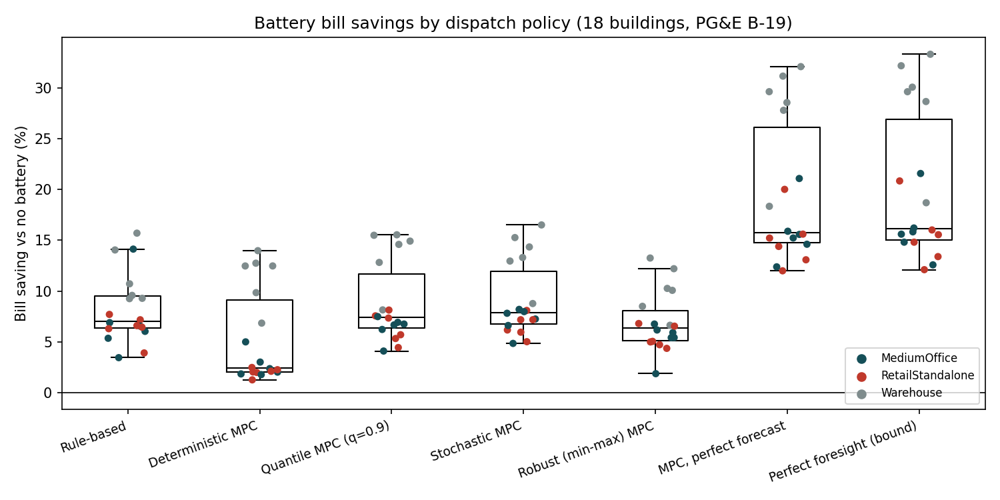
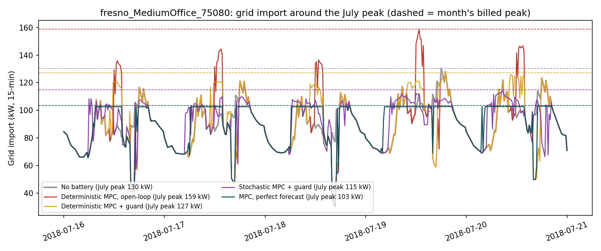

# 需量电费下的储能调度：MILP、MPC 与预测误差的代价

**面向商业建筑的"光伏 + 用户侧储能"经济调度。使用真实电价（PG&E B-19），用 Pyomo 写成与求解器无关的模型，结合滚动时域 MPC，并在受控条件下比较了几种处理预测不确定性的方法。**

[展示页](https://dgh19981102-max.github.io/microgrid-dispatch-milp/) ·
[完整结果（英文）](results/summary/RESULTS.md) · [English README](README.md) ·
[学习指南](LEARNING_GUIDE_zh.md)



## 核心问题与结论

实验对象为 18 栋模拟商业建筑（NREL ComStock 数据）：中型办公楼、独立零售店、仓库各 3 栋，分布在加州气候温和的沿海（阿拉米达县）和炎热的内陆（弗雷斯诺县）两地。时间分辨率 15 分钟，评估期为 2 月到 12 月（10.9 个月）。光伏按年用电量的 30% 配置；电池功率为年峰值的 25%，时长 2 小时。节省均相对于"同一建筑、有光伏、无电池"；置信区间为按建筑重抽样的 95% bootstrap。

| 问题 | 结论 |
|---|---|
| 电池最多能省多少？ | 完美预测下可省电费的 **20.1%** [17.0, 23.5]。24 小时窗口的 MPC 在完美预测下能拿到其中的 97.7%，说明预测窗口长度不是瓶颈。 |
| 现实可行的控制器能省多少？ | 随机 MPC **9.1%**，分位数 MPC 8.8%，设计合理的规则策略 8.3%，最坏情况鲁棒 MPC 6.9%，确定性 MPC 5.4%。最好的策略约拿到理论上限的 46%。 |
| 考虑不确定性值不值？ | 相对确定性 MPC 值得：随机 MPC 在 **18 栋建筑中全部更优**（+3.7 个百分点，置信区间 [3.0, 4.4]）。但相对规则策略只多 0.8 个百分点，置信区间 [−0.6, 2.1]，**统计上不显著**。最坏情况鲁棒 MPC 过于保守，18 栋中全部不如随机 MPC。 |
| 预测精度值多少钱？ | 高度非线性：节省从完美预测的 19.6%，降到误差为现有一半时的 7.7%，之后趋于平缓。在现有预测水平附近，误差每降低 10%，**每栋建筑每年只多省约 $174**。 |
| 执行方式重要吗？ | 和算法一样重要。开环执行（每小时的功率设定值固定不变，没有实时需量守护器）时，确定性 MPC **反而亏 1.5%**，18 栋中有 11 栋比不装电池还差。加上守护器后，每种策略的节省都提高了 5～7 个百分点。 |
| 0-1 变量必要吗？ | 在 B-19 电价下不必要：**230 万次** MPC 求解中，没有一次需要回退到 MILP。但在负电价时段（65% 的窗口 LP 出错）或上网电价高于购电价时（54%），就必须用 MILP。 |
| 电池装多大合适？ | 容量越大总节省越多，但每 kWh 的边际价值递减：10 年回本的盈亏平衡造价从 $3,354/kWh（峰值的 10%）降到 $1,610/kWh（50%），这是理论上限。按随机 MPC 的实际水平，25% 容量对应约 **$1,035/kWh**。 |

## 难点：需量电费的"棘轮效应"

在 B-19 电价下，需量电费占可变电费的 **49%～67%**，按**整月**最高的 15 分钟平均购电功率计费。峰值一旦被推高就无法撤回，之后的决策都会把"这个水平以下的购电"视为免费。确定性 MPC 如果低估了负荷，就会安排充电；实际负荷一高，峰值就被推高，控制器随后又放心地把充电排到新的水平。下图是 7 月的一周：



## 代码结构

```
src/mgdispatch/
  tariff.py      分时电价 + 月度需量电费，YAML 声明式配置，支持夏令时
  model.py       Pyomo MILP（确定性 / 两阶段随机 / 最坏情况），支持变步长
  solve.py       与求解器无关的求解接口（HiGHS、CBC、Gurobi、CPLEX）+ "先 LP、违规再 MILP"
  fastlp.py      同一个 LP 直接构造成稀疏矩阵交给 HiGHS（快 10 倍，与 Pyomo 版交叉测试）
  billing.py     独立的账单计算，用来给所有策略打分
  data.py        ComStock / NSRDB / PVGIS 数据读取、时区对齐、pvlib 光伏模型
  checks.py      用"室外照明开灯时刻 vs 日落时刻"验证负荷数据的时区
  forecast.py    只用过去数据的负荷/光伏预测，以及误差轨迹场景抽样
  simulate.py    15 分钟电站模拟、实时需量守护器、规则策略、各种 MPC
  runner.py      可续跑的实验运行器（每周断点，每次运行一个 JSON）
experiments/     编号 00–09 的实验脚本、configs/*.yaml、run_all.py（分片）、plan.py
tests/           66 个单元测试（手算最优解、Pyomo 与快速版一致性、因果性、断点续跑）
results/         每个实验一个 runs.jsonl（每行是一次运行的原始 JSON；用 experiments/pack_results.py --unpack 可还原成单独文件）、summary/RESULTS.md、图表
docs/            GitHub Pages 展示页
```

## 复现

```bash
pip install -r requirements.txt
python -m pytest -q                                   # 约 1 分钟
python experiments/run_all.py --quick                 # 冒烟测试，约 3 分钟
python experiments/run_all.py --shard 0/2             # 完整运行（两个分片并行）
python experiments/06_milp_vs_lp.py && python experiments/07_solvers.py
python experiments/08_summarize.py && python experiments/09_dispatch_example.py
```

仓库已包含处理好的 `data/processed/`，所以实验 02～09 不需要下载原始数据。原始数据用 `scripts/download_data.py` 下载，再运行 `experiments/01_prepare_data.py` 处理。`run_experiments_colab.ipynb` 可以在免费 Colab 上跑完全部实验，结果存到 Google 云盘，断线后可续跑。求解器在 `experiments/configs/base.yaml` 里改一行即可切换。

## 局限性（使用结论前请先阅读）

* **负荷是模拟数据**：ComStock 的负荷比真实电表数据更平滑、更规律，负荷预测误差只有 3%～8%。换成真实数据，预测误差带来的损失很可能更大。
* **年份不一致**：负荷和天气是 2018 年的，电价是 2026 年的。节假日、尖峰日电价、税费和功率因数调整都没有考虑；上网电价用固定的 $0.05/kWh 作为假设，没有采用 PG&E 净计费电价（NBT）的逐时数值。
* **统一的系统规模**：光伏和电池按固定比例配置；所有建筑都用 B-19 电价，而最小的几栋建筑可能选择 PG&E 的其他电价更划算。
* **预测模型较简单**：负荷用相似日法，光伏用晴空包络加持续性法。实验 05 覆盖了更好和更差的预测精度，但没有测试更强的机器学习预测模型。
* **经济性估算**：盈亏平衡造价没有考虑折现、补贴、容量衰减和运维成本。NREL 指出工商业储能的成本数据非常有限，实际判断请以供应商报价为准。
* **守护器假设**：实时需量守护器按当前 15 分钟的实际负荷动作，即假设本地有快速响应的控制器（商业储能系统通常具备）。
* **开发中的修正**（详见学习指南）：独立账单测试抓到了 pandas 3 时间单位变化导致的 bug；第一版规则策略忽略了电池的电量限制；开环执行的问题促成了实时需量守护器。守护器在完整运行前已经声明，开环版本作为消融实验一并报告。

## 许可

MIT。数据来源：NREL ComStock 与 NSRDB（公开）、PVGIS（欧盟联合研究中心）、PG&E 电价表。
